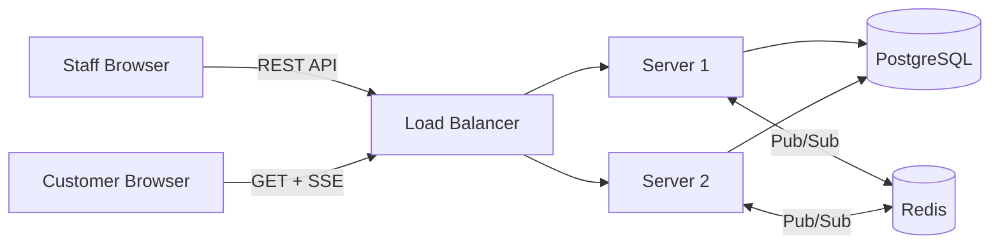
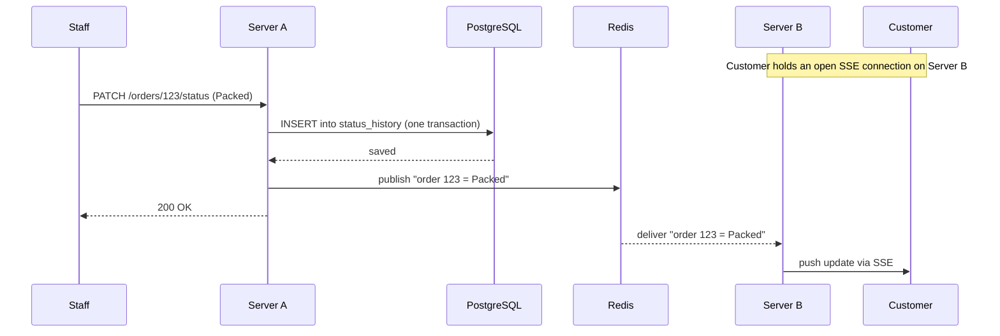
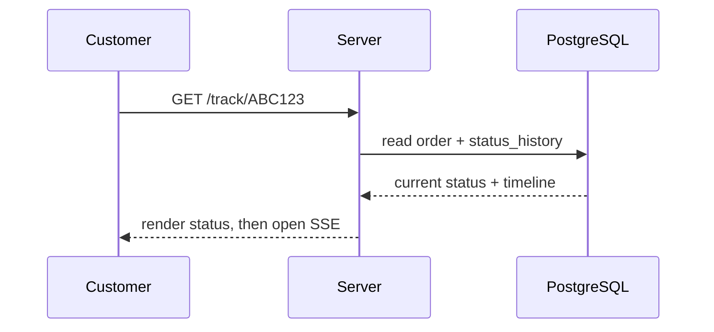

# Order Tracker — System Design (v1)

## Overview

Shop staff manage orders through an authenticated dashboard. Customers follow an order through a public tracking link and see status changes live, without refreshing. The two sides are intentionally asymmetric: staff write data through a normal REST API, while customers only read and subscribe to a live stream.

The core technical challenge is delivering status changes to customers in near real time, reliably, under bursts of load — without ever losing an order.

## Stack

| Concern | Choice |
|---|---|
| Backend | NestJS (Node + TypeScript) |
| Database | PostgreSQL |
| Live updates | Server-Sent Events (SSE) |
| Fan-out across servers | Redis Pub/Sub |
| Frontend | React |
| Auth | Self-built JWT (staff only) |

## Architecture

A load balancer spreads traffic across multiple stateless servers. All servers share one PostgreSQL database (the source of truth) and one Redis instance (the live-update bus). Any server can handle any request; no server holds unique state beyond the SSE connections currently attached to it.

## Key flows

### Status change propagated live

The hardest path. Staff may act on one server while the customer's live connection is held by another. Redis bridges them.

### Customer opens a tracking link

Current state is always read from the database, so the page is correct even if an earlier live push was missed. The SSE stream is opened afterward for subsequent changes.

## Data model

No `status` column is stored on `orders`. The current status is derived from the most recent `status_history` row, keeping a single source of truth and avoiding two writes that can drift apart.

### `orders`

| Column | Notes |
|---|---|
| id | primary key |
| tracking_code | unique, random, unguessable — this is the only access control for customers |
| customer_name | |
| customer_phone | |
| address | delivery address |
| items | free text in v1 |
| amount | |
| created_at | |

### `status_history`

| Column | Notes |
|---|---|
| id | primary key |
| order_id | foreign key → `orders.id` |
| status | one of: Placed, Packed, On the way, Delivered, Cancelled |
| changed_at | when the change happened |
| changed_by | staff who made the change (audit) |

One order has many history rows. The timeline shown to the customer is simply this table, ordered by `changed_at`.

### `staff`

| Column | Notes |
|---|---|
| id | primary key |
| email | unique |
| password_hash | bcrypt/argon2 — never plain text |
| created_at | |

Single role in v1. Admin/staff separation is deferred.

## API

### Staff (JWT required)

| Method | Path | Purpose |
|---|---|---|
| POST | /orders | Create an order |
| GET | /orders | List active orders |
| PATCH | /orders/:id/status | Advance status (writes a `status_history` row) |
| PATCH | /orders/:id/cancel | Cancel the order |

### Customer (no auth — tracking code is the key)

| Method | Path | Purpose |
|---|---|---|
| GET | /track/:code | Current status + timeline |
| GET | /track/:code/stream | SSE connection for live updates |

### Auth

| Method | Path | Purpose |
|---|---|---|
| POST | /auth/login | Email + password → JWT |

## Design decisions and trade-offs

**SSE over WebSockets.** Data flows one way, server to customer. SSE runs over plain HTTP, reconnects automatically, and passes through most proxies. WebSockets' bidirectional channel would be unused complexity.

**Current status is computed, not stored.** Only `status_history` is written. The current status is the latest row. This removes the risk of `orders.status` and the history disagreeing. If read performance becomes a problem at scale, a cached `status` column can be reintroduced and kept fresh by a trigger.

**The database is the source of truth; the live channel is a best-effort accelerator.** If a Redis publish fails, the database is still correct. The customer page self-heals, because it re-reads current state from the database on initial load and on every SSE reconnect. Live updates make the experience feel instant; they are never trusted for correctness.

**Dual-write is a known gap in v1.** Saving to the database and publishing to Redis are two separate operations; the publish can fail after the write succeeds. In v1 this is acceptable because the self-healing read covers it. At scale, the Outbox pattern closes the gap: the status change and an outbox row are written in a single transaction, and a separate worker publishes from the outbox with retries, so no event is permanently lost.

**Status changes are validated server-side.** The client sends an explicit target status for flexibility, but the server never trusts it. It verifies the status is valid and the transition is allowed (forward only; terminal states — Delivered, Cancelled — cannot change) before writing history and publishing.

**Auth is built in-house.** Only staff authenticate, a small and controlled set of users with no social login or SSO needs. Building JWT auth with hashed passwords keeps the system self-contained and surfaces the mechanics directly. A third-party provider becomes worthwhile only if customer accounts, social login, or multi-tenant SSO are added later.

**Tracking code is the security boundary.** With no customer login, a guessable code would expose other customers' orders. The code is random and long enough to be effectively unguessable (nanoid-style), never sequential.

## Deployment target

Production runs on AWS, using the container/VM path rather than serverless so that long-lived SSE connections are supported.

| Component | AWS service |
|---|---|
| NestJS servers | ECS/Fargate (or EC2) behind an Application Load Balancer |
| PostgreSQL | RDS |
| Redis | ElastiCache |
| Load balancer | ALB (supports long-lived SSE connections) |

API Gateway + Lambda is explicitly avoided for the request path: Lambda's execution limits and response buffering do not suit long-open SSE streams.

Three constraints shape the build from day one, even though deployment happens after v1 runs locally:
- The host must support long-lived connections (ALB does); serverless request paths are ruled out for SSE.
- PostgreSQL and Redis exist as managed services (RDS, ElastiCache); the app reaches them only through environment variables.
- Running multiple servers behind the ALB makes Redis Pub/Sub mandatory — a customer's SSE connection and the staff request that triggers an update may land on different servers.

Detailed deployment work (Docker images, CI/CD, VPC, security groups, domain, TLS) is carried out once v1 works end to end.

## Deferred to later versions

Payments · live map / GPS · customer accounts · multiple shops · SMS/email notifications · ratings and reviews · Outbox pattern + dedicated message broker · admin/staff roles.
